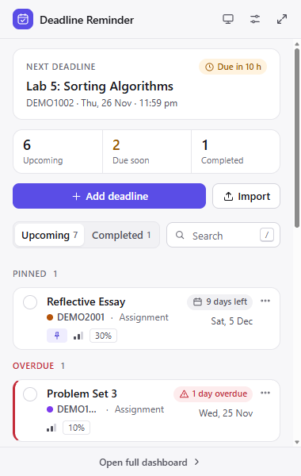
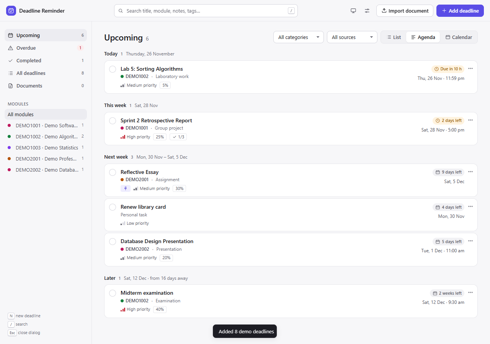
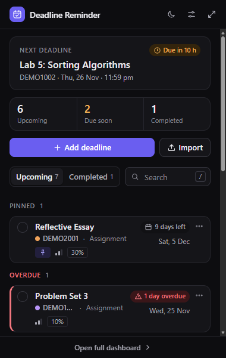
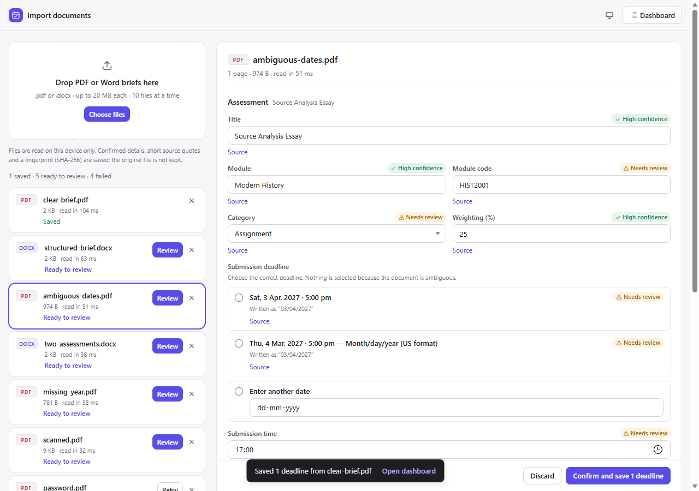
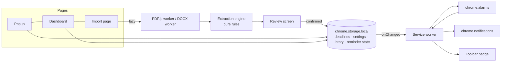

# Deadline Reminder

**A local-first Chromium extension that keeps track of assessment deadlines, reads them
from PDF and Word briefs, and reminds you before they are due.**

No account, no server, no API key and no tracking: everything runs and stays in your
browser. Deadline Reminder is an independent academic productivity project; it is not
affiliated with any college, learning platform or browser vendor.

> Extracted deadlines are suggestions. Always check them against the original
> assessment brief and your college's official deadline information.

| Popup                                                   | Dashboard (agenda)                                                    |
| ------------------------------------------------------- | --------------------------------------------------------------------- |
|  |        |
|    |  |

All screenshots use synthetic demo data. More in [docs/screenshots](docs/screenshots).

## The problem

Assessment briefs arrive as PDFs and Word files, each with its own layout, and the
real submission deadline is often buried next to release dates, presentation slots and
feedback dates. Students end up copying dates by hand into calendars, or missing them.
Deadline Reminder gives you one quiet place for every deadline, can read the brief for
you (showing exactly where each detail came from), and nudges you at sensible times.

## Features

**Deadlines**

- Add a deadline with just a title and a date; module, time, weighting, priority,
  requirements, deliverables checklist, instructions, marking criteria, other dates,
  notes, links, tags and per-deadline reminders are optional.
- Popup for daily use: next deadline with countdown, counts, quick add, search, module
  filter chips, Pinned / Overdue / Today / Tomorrow / This week / Next week / Later
  groups, and a per-card menu (edit, pin, snooze, details).
- Dashboard: list, agenda and month calendar; status, module, category and source
  filters; sorting; module colour labels; pinned deadlines; document library; settings.
- Mark complete with undo, safe delete with undo, editable checklists, notes.

**Document import**

- Import PDF and DOCX briefs (several at once, drag and drop, progress, cancel).
- Local, rule-based extraction of title, module, type, deadline and time, weighting,
  submission method, deliverables, word count, presentation date and duration, group
  size, marking criteria, instructions and other dates, each with its source line and
  page or paragraph.
- Irish/European date handling. Ambiguous dates (`03/04/2027`), missing years and
  "due by Friday" are offered as choices and never picked for you.
- Review screen to correct everything before saving; nothing is saved automatically.
- SHA-256 duplicate detection: identical files, renamed copies, and updated versions
  (shown as a field-by-field comparison that never overwrites your own entries silently).

**Reminders**

- Browser notifications 14, 7, 3 or 1 day before, on the deadline day, 1 hour before
  (when a time is known), or at any custom interval; per-deadline overrides.
- Notification buttons: **Mark complete** and **Snooze**; clicking opens the deadline.
- Missed reminders (browser closed) are summarised once at start-up, not flooded.
- Toolbar badge: due soon, overdue, upcoming, or off.

**Data**

- JSON backup with a privacy warning; restore with a preview and no duplicates.
- Optional demo data you can add and remove separately; a separate, confirmed reset.
- Light, dark and system themes; keyboard shortcuts; accessible dialogs and menus.

## Supported browsers

| Browser                                         | Status                                                                                                                             |
| ----------------------------------------------- | ---------------------------------------------------------------------------------------------------------------------------------- |
| Microsoft Edge 123+                             | Tested (headless Edge 158 with the unpacked release build)                                                                         |
| Google Chrome 123+                              | Expected to work (same Chromium extension APIs); **not tested in this release** because Chrome was not available in the test setup |
| Other Chromium browsers (Brave, Vivaldi, Opera) | Tested works in Brave and OperaGX                                                                                                                        |

Firefox and Safari are not supported.

## Supported document formats

PDF (`.pdf`, text-based) and Word (`.docx`). Scanned/image-only PDFs are detected but
not read (no OCR). Legacy `.doc`, macro-enabled `.docm`, templates, RTF and ODT are
refused. Details: [docs/DOCUMENT_IMPORT.md](docs/DOCUMENT_IMPORT.md).

## How reminders behave

- Reminders use `chrome.alarms` and `chrome.notifications` from the Manifest V3 service
  worker. They are rebuilt on install, update and browser start-up, and whenever a
  deadline or setting changes. Completed and deleted deadlines lose their reminders;
  reopened ones get them back.
- **Date-only deadlines** have no official time, so whole-day reminders fire at your
  configured reminder time (default 09:00) and "1 hour before" is skipped.
- Reminder times are calculated in each deadline's time zone (default Europe/Dublin), so
  daylight-saving changes and changing the computer's time zone do not shift them.
- **Limits:** browser alarms are not exact and may arrive a few minutes late. Nothing can
  be shown while the browser or computer is off; reminders missed in that time (up to
  three days back) are summarised in one notification when the browser starts. This is a
  convenience tool, not a guaranteed replacement for official deadline information.

## Privacy and security

- Permissions: `storage`, `alarms`, `notifications` only. No host permissions, content
  scripts, tabs/history/cookies access, or exposed resources.
- No network requests, telemetry, accounts or AI services. PDF.js and Mammoth are
  bundled; nothing is loaded from a CDN. The extension page CSP is
  `script-src 'self'; object-src 'self'`.
- Documents are untrusted input: type, signature, size and structure are checked first;
  archive bombs, macros and password-protected files are refused; text is never
  rendered as HTML. Original files are kept only if you turn that on.
- See [SECURITY.md](SECURITY.md) for the audit and how to report problems.

## Technology

Plain JavaScript (ES modules), HTML and CSS · Manifest V3 · Vite · Vitest · ESLint ·
Prettier · [PDF.js](https://mozilla.github.io/pdf.js/) (Apache-2.0) ·
[Mammoth.js](https://github.com/mwilliamson/mammoth.js) (BSD-2-Clause) · Web Crypto ·
IndexedDB (optional file storage) · GitHub Actions. No UI framework.

## Architecture



Pages never talk to the service worker directly; everything goes through storage, so
there is no message channel to secure. More in [docs/ARCHITECTURE.md](docs/ARCHITECTURE.md).

```text
src/
  background/   service worker and reminder runner
  popup/ dashboard/ import/   the three extension pages
  components/   cards, dialogs, forms, menus, review, library, settings
  extraction/   date parser and assessment extraction engine (pure)
  documents/    file checks, PDF/DOCX readers, workers, import pipeline
  services/     storage, migrations, reminders, query, imports, duplicates, backup, demo
  models/ utils/ styles/
public/         manifest, icons, third-party notices
scripts/        build checks, packaging, notices, fixtures, measurements, browser tests
tests/          Vitest unit and integration tests
demo/briefs/    synthetic PDF/DOCX briefs to try the import
docs/           architecture, document import, screenshots
```

## Quick start (install the release)

1. Download `deadline-reminder-v1.0.0.zip` from the release and extract it.
2. Open `chrome://extensions` (Microsoft Edge: `edge://extensions`).
3. Turn on **Developer mode**.
4. Choose **Load unpacked**.
5. Select the extracted `deadline-reminder-v1.0.0` folder (the one containing
   `manifest.json`).

Pin the extension from the toolbar's extensions menu. To try it quickly, open
**Settings → Demo data → Load demo deadlines**, or import the files in `demo/briefs/`.

## Build from source

Requires [Node.js](https://nodejs.org/) 20 or later.

```powershell
git clone <repository-url> deadline-reminder
cd deadline-reminder
npm ci
npm run build
```

Then load the `dist` folder with **Load unpacked** as above.

## Development

| Command                                  | What it does                                                                                                       |
| ---------------------------------------- | ------------------------------------------------------------------------------------------------------------------ |
| `npm run dev`                            | Rebuild `dist/` on every change (reload the extension to see it)                                                   |
| `npm run build`                          | Production build + verification (manifest paths, permissions, CSP, no remote code, version sync, parser isolation) |
| `npm test`                               | Unit and integration tests (Vitest, mocked Chrome APIs)                                                            |
| `npm run lint` / `npm run format`        | ESLint / Prettier                                                                                                  |
| `npm run check`                          | Lint, format check, tests and build                                                                                |
| `npm run package`                        | Create `release/deadline-reminder-v<version>.zip` and its SHA-256                                                  |
| `npm run release:check`                  | Build, package, then install the ZIP in headless Edge and run the release checks                                   |
| `npm run smoke` / `npm run smoke:import` | Browser tests of the UI and of document import (Edge or `BROWSER_PATH`)                                            |
| `npm run fixtures`                       | Write the synthetic test briefs to `fixtures-output/` (`-- --demo` refreshes `demo/briefs/`)                       |
| `npm run measure`                        | Time PDF/DOCX processing on synthetic briefs                                                                       |
| `npm run notices`                        | Regenerate `public/THIRD_PARTY_NOTICES.txt`                                                                        |

## Testing

- **218 automated tests** (Vitest): reminders (scheduling, cancellation, updates,
  completion, restart reconciliation, missed reminders, duplicate prevention, snooze,
  time zones, daylight saving, date-only deadlines), the service-worker reminder flow
  with mocked `chrome.*` APIs, storage and migrations, backup/restore, demo data,
  extraction, PDF/DOCX reading on real synthetic files, file validation (corrupt,
  password, macro, archive bomb), duplicate imports, confirmation, search and filtering.
- **Browser tests** (headless Edge, real unpacked extension over the DevTools protocol):
  UI, document import, and a release check that installs from the ZIP and confirms a
  real alarm creates a real notification.
- Mocked tests prove the logic, not that the operating system displays notifications.

## Performance (v1.0.0, synthetic data)

| Measure                                     | Result                                                       |
| ------------------------------------------- | ------------------------------------------------------------ |
| Popup JavaScript loaded up front            | 48 KB (65.5 KB in v0.2.0)                                    |
| Popup open (headless Edge, median of 5)     | about 30–40 ms                                               |
| Release ZIP                                 | about 0.7 MB (mostly PDF.js, loaded only on the import page) |
| PDF 50 pages / DOCX 2,400 paragraphs (Edge) | about 110–150 ms / 85–100 ms                                 |

Full figures and their limits: [DEVELOPMENT_STATUS.md](DEVELOPMENT_STATUS.md).

## Known limitations

- Reminders need the browser to be running and may be a few minutes late.
- No OCR; DOCX headers, footers and footnotes are not read; English-language rules.
- Data lives in one browser profile; use backup/restore to move it. No sync.
- Not published on the Chrome Web Store; installed as an unpacked extension.

## Roadmap

- Optional local OCR for scanned briefs.
- Reminders for presentation and exam dates.
- Firefox port and a Chrome Web Store listing.
- More extraction rules, evaluated on a private set of real briefs.

## Licence

MIT — see [LICENSE](LICENSE). Third-party licences are in
[public/THIRD_PARTY_NOTICES.txt](public/THIRD_PARTY_NOTICES.txt) and ship with the
extension.
