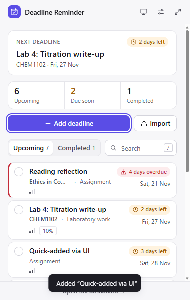
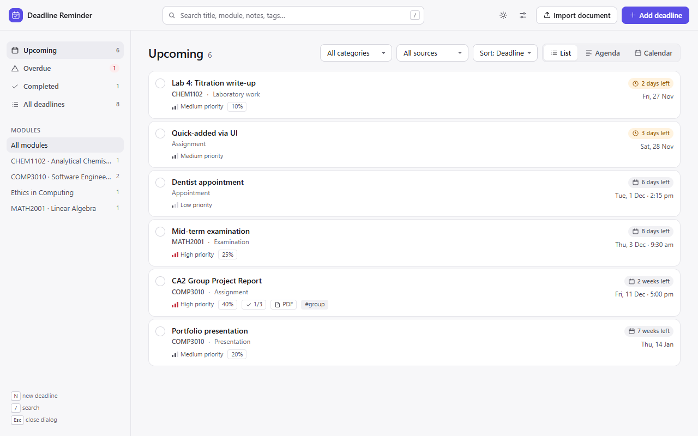
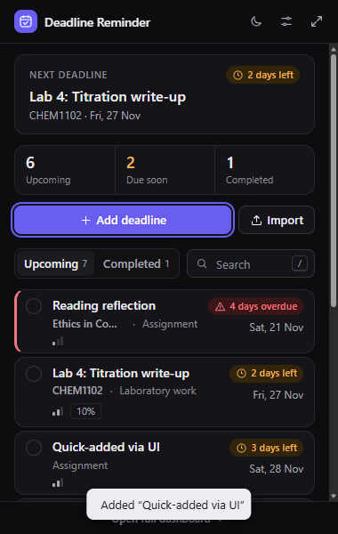
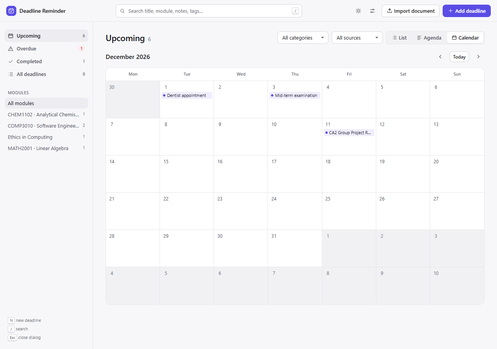

# Deadline Reminder

A lightweight, local-first browser extension for Chromium browsers (Google Chrome and
Microsoft Edge) that keeps track of assessment and personal deadlines and reminds you
before they are due.

- **Manual first.** A deadline needs only a title and a date. Everything else is optional.
- **Document-ready.** PDF and Word briefs can already be linked to a deadline. Automatic
  extraction of deadline details from briefs is planned for the next stage and is clearly
  marked as "in development" in the interface.
- **Private.** No accounts, servers, analytics or network requests. Data stays in your
  browser profile.
- **Small.** Plain JavaScript, no runtime dependencies, about 116 KB installed.

Inspired by the author's earlier Python _Deadline Planner_ project, but fully
independent of it.

| Popup                                                        | Dashboard                                                                    |
| ------------------------------------------------------------ | ---------------------------------------------------------------------------- |
|  |          |
|    |  |

More screenshots are in [docs/screenshots](docs/screenshots).

## Features (Stage 1)

- Popup with the next deadline, counts (upcoming, due soon, completed), quick add,
  search and Upcoming/Completed tabs.
- Full dashboard in a browser tab: list, agenda and calendar views; status, module,
  category and source filters; search; sorting by deadline, priority or title.
- Create, edit, delete (with undo), complete and restore deadlines.
- Optional fields: module name and code, submission time, weighting, priority,
  description/requirements, notes, submission link, deliverables checklist, reminders,
  estimated time and tags.
- Categories for assignments, exams, presentations, group projects, lab work, personal
  tasks, appointments and more, plus your own custom categories.
- Browser notification reminders (default: 1 week and 1 day before, configurable per
  deadline), rescheduled automatically when a deadline changes.
- Link a PDF or DOCX brief to any deadline (file name and size only; the file is not stored).
- Backup to a JSON file and restore (merge or replace).
- Light, dark and system themes. Keyboard shortcuts: <kbd>N</kbd> new deadline,
  <kbd>/</kbd> search, <kbd>Esc</kbd> close dialog, <kbd>Ctrl</kbd>+<kbd>Enter</kbd> save,
  <kbd>Alt</kbd>+<kbd>Shift</kbd>+<kbd>D</kbd> open the popup.
- Time-zone aware: date-only deadlines never shift a day; the default zone is
  Europe/Dublin and can be changed.

## Install from source

Requirements: [Node.js](https://nodejs.org/) 20 or later and npm.

```powershell
git clone <your-fork-url> deadline-reminder
cd deadline-reminder
npm ci
npm run build
```

The installable extension is written to `dist/`.

### Load the unpacked extension

**Chrome:** open `chrome://extensions`, turn on **Developer mode**, choose
**Load unpacked** and select the `dist` folder.

**Edge:** open `edge://extensions`, turn on **Developer mode**, choose **Load unpacked**
and select the `dist` folder.

Pin the extension from the toolbar's extensions menu to keep it one click away. After
rebuilding, press the reload button on the extension's card.

## Development

| Command           | What it does                                                                              |
| ----------------- | ----------------------------------------------------------------------------------------- |
| `npm run dev`     | Rebuilds `dist/` on every change (reload the extension to see it)                         |
| `npm run build`   | Production build plus checks on the output (`scripts/verify-build.mjs`)                   |
| `npm test`        | Unit tests with Vitest                                                                    |
| `npm run lint`    | ESLint                                                                                    |
| `npm run format`  | Prettier                                                                                  |
| `npm run check`   | Lint, format check, tests and build                                                       |
| `npm run preview` | Serves `dist/` at http://localhost:4173 for UI work in a normal tab                       |
| `npm run smoke`   | Optional: loads `dist/` in headless Edge and drives the UI (needs Edge or `BROWSER_PATH`) |
| `npm run icons`   | Regenerates the PNG icons                                                                 |

`npm run preview` opens the pages outside the extension, so they fall back to
`localStorage` and reminders are not scheduled. Use the unpacked extension for real
testing.

## Permissions

| Permission      | Why                                                |
| --------------- | -------------------------------------------------- |
| `storage`       | Save deadlines and settings in the browser profile |
| `alarms`        | Wake the extension when a reminder is due          |
| `notifications` | Show the reminder                                  |

No host permissions, content scripts, history, cookies or tab access are requested.

## Privacy

Deadline Reminder makes no network requests and collects no data. Deadlines, settings
and linked document names are stored only in `chrome.storage.local` in your browser
profile. Removing the extension deletes them; export a backup first if you want to keep
them.

## Project documents

- [docs/ARCHITECTURE.md](docs/ARCHITECTURE.md): structure, data model, storage and design decisions
- [DEVELOPMENT_STATUS.md](DEVELOPMENT_STATUS.md): what is done and what comes next
- [AGENTS.md](AGENTS.md): working rules for contributors and coding agents

## Limitations

- Reminders fire only while the browser is running (a browser limitation for extensions).
- Automatic extraction from PDF and Word briefs is not implemented yet.
- Data is per browser profile; there is no sync between devices (use backup/restore).

## Licence

[MIT](LICENSE)
